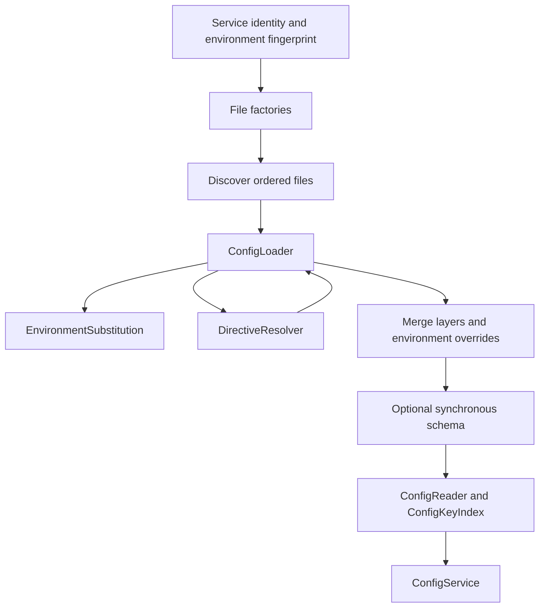

# Internal architecture

The public API remains synchronous and exported through `@gaia-framework/config`. Internal
modules separate loading, resolution, merging, validation, reading and service
reuse. They are implementation details, not additional package export paths.

## Responsibilities

| Module | Responsibility |
| --- | --- |
| `src/config.ts` | Public factories, discovery, layer ordering, merge/override orchestration and schema execution |
| `src/loadOptions.ts` | Public loading options and internal resolved-input types; ConfigSchema, ConfigFileFormat and LoadConfigOptions are re-exported at the root |
| `src/loader/ConfigLoader.ts` | Format dispatch, YAML parsing, root checks, shared object/array traversal and YAML graph-cycle detection |
| `src/loader/TomlParser.ts` | Fatal UTF-8 decoding, pinned TOML parsing and normalization of TOML-only types, null markers and depth |
| `src/loader/EnvironmentSubstitution.ts` | Own-entry environment lookup, process fallback, placeholder parsing, escaping and boolean fallback coercion |
| `src/loader/DirectiveResolver.ts` | Environment/text/include directives, relative resolution, fragment selection and per-loader include reuse |
| `src/loader/canonicalPath.ts` | Canonical identity for include cycles, preserving lexical include contexts and Windows compatibility |
| `src/services/configServiceCache.ts` | Schema-partitioned service maps, environment fingerprints, cache keys and the guarded test reset |
| `src/merge.ts`, `src/envOverrides.ts` | Deep object merging, replacement/clearing rules and ordered environment overrides |
| `src/inputValidation.ts` | Iterative in-memory object/root and cycle checks |
| `src/reader/ConfigReader.ts` | Getter contracts, traversal, options and lookup caches |
| `src/reader/ConfigKeyIndex.ts` | Construction-time key capture and lazy literal-path materialization |
| `src/reader/immutableSnapshot.ts` | Optional descriptor-aware plain-data copy and freezing |
| `src/services/ConfigService.ts` | Existing Inversify-decorated reader delegation |

## Preserve resolution context

Each loader owns one environment helper and one directive resolver. The resolver
owns its include cache for exactly that loader's lifetime. Two narrow callbacks
let it parse included files and re-enter the loader's traversal with the same
include stack and object-ancestor set. There is no new provider registry or public
plugin interface.

Canonical paths identify active include cycles. Lexical paths still determine
relative resolution, cache keys and error chains. Every include reference checks
existence and cycle identity before cache reuse. File layers retain separate
loaders; caches are not silently shared across layers or processes.

Environment lookup still reads the supplied options at use time. Supplied maps,
empty masking, process fallback, Windows case rules and non-enumerable own entries
retain their documented behavior. Unknown directive-like keys and objects with
extra keys remain ordinary configuration data.

Ordinary strings bypass placeholder regex processing, including directive
arguments. Each environment helper lazily allocates a bounded cache for parsed
expression names, normalized fallbacks and boolean-fallback metadata. It never
stores environment values or substituted results. Cache saturation and long
expressions fall back to ordinary parsing; no global cache or new lifecycle API
is introduced. Admitted expression strings are detached from their source storage
without changing UTF-16 contents, so a short cached substring cannot retain a
large input string. The separate resolved-include cache retains its existing semantics.

## Service cache boundary

Reader result caches are separate from service identity. Each reader owns one map
for raw string keys and another for serialized segment-array keys. Cached results
make retaining parsed paths redundant. Array paths still validate/copy on every
call, failures remain uncached, and getter conversions retain their existing
observation behavior. See [cache semantics](loading.md#caching-and-fresh-reads).

Factories resolve discovery inputs and ask the internal cache module for the
same key and schema partition as before. They still recheck discovery during a
miss and loading; options are not eagerly flattened or snapshotted into a new
public abstraction. Getter-backed options and file appearance/disappearance retain
their previous observation order.

Fingerprint values remain hashed. The process/map source distinction, ordered
override enumeration, schema identity and reader/error options are retained.
Failed loads or schema validation never enter the service cache. Cache ownership
is process-local and the test reset retains its existing environment guard.

## Why graph traversals remain separate

The traversal profiling work measures cycle checking, schema processing, snapshot
copying, indexing and complete reader/factory construction independently:

| Stage | Purpose |
| --- | --- |
| Pre-schema graph guard | Prevent cyclic in-memory input from reaching a recursive schema; reject accessors in immutable mode |
| Schema execution | Validate, default and transform; may return a different object graph |
| Optional snapshot copy | Create detached/frozen supported data while preserving shared references |
| Reader root/graph guard | Validate the resulting root and reject cycles introduced by schema transforms |
| Key indexing | Capture enumeration at construction while treating arrays as leaves |

These stages intentionally visit different property sets and perform different
work. Ordinary input getters can observe repeated reads. Schemas can mutate data
or return a different graph. Snapshot copying preserves hidden/symbol data and
rejects unsupported values. A passed pre-schema guard is not proof that the final
reader graph is safe, and an index that treats arrays as leaves cannot replace a
cycle check inside array contents.

Validation passes remain separate to preserve those responsibilities. The
synthetic contract regression tests preserve getter call counts, rejection before schema
execution, transformed-cycle rejection, immutable restrictions and error behavior.
See the [benchmark methodology](benchmarking.md).

## Application compatibility

[Layered service](../examples/11-service/README.md) and
[Modular pipelines](../examples/12-pipelines/README.md) examples use independent
service and batch-processing schemas, synthetic values and nested fragments.
Tests check every factory, file layers, values/errors, defaults/coercion, cache
identity and immutable results. Installed consumers repeat these checks through
compiled and development exports.

Applications own their schemas, composition and service startup. Library checks
cover configuration behavior and package integration; application deployment
acceptance remains separate. See [contributor testing](../CONTRIBUTING.md#testing).
